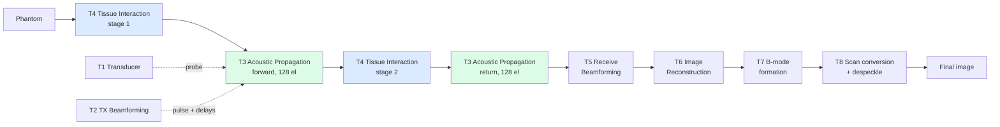
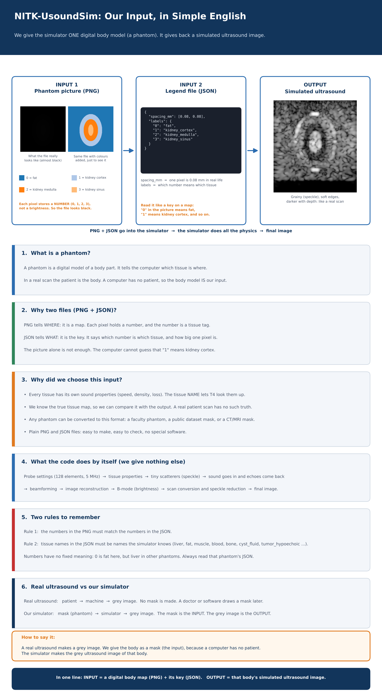

# NITK-UsoundSim v2

> **v2 = the integrated pipeline built from the updated team modules.** The first project is a separate repository and is unchanged.

End-to-end **in silico ultrasound imaging** pipeline (NITK Surathkal, SPML). Each team builds one module; modules are then
joined step by step as a relay race, where every runner hands a labelled array to the next.

[](https://github.com/darshilgmaniya/NITK-UsoundSim-v2/actions)
 



## Our input in one picture (to explain to sir)



**Real ultrasound makes a grey image. We give the body as a mask (the input) because a computer has no patient. The simulator makes the grey ultrasound image of that body.**

*Input = a digital body map (PNG) + its key (JSON). Output = that body's simulated ultrasound image. Ready-made inputs: `input_phantoms/` (coloured previews in `input_phantoms/preview/`).*

## Start here
| I want to... | Go to |
|---|---|
| **Give any phantom, get the final image** | [`integration/03_full_pipeline`](integration/03_full_pipeline) |
| Run the whole AP + TI relay | [`integration/01_ap_ti_relay`](integration/01_ap_ti_relay) |
| Work on my own team's folder | [`teams/`](teams) (T1 to T8, one folder per team, each with its own notebook) |
| Know the exact arrays handed between teams | [`docs/06_DATA_DICTIONARY.md`](docs/06_DATA_DICTIONARY.md) |
| Understand how it fits together | [`docs/03_ARCHITECTURE.md`](docs/03_ARCHITECTURE.md) |
| Add the next team's module | [`docs/11_DEVELOPER_GUIDE.md`](docs/11_DEVELOPER_GUIDE.md) |
| Read everything, by audience | [`docs/README.md`](docs/README.md) (index of 15 documents, migration guide) |
| Read it as one document | [`docs/NITK-UsoundSim_Integration_Technical_Report.pdf`](docs/NITK-UsoundSim_Integration_Technical_Report.pdf) (35 pages) |
| Receive the echo data (Receiver Beamforming) | [`docs/10_RECEIVER_BF_HANDOFF.md`](docs/10_RECEIVER_BF_HANDOFF.md) |
| Run the whole chain, phantom to image | [`docs/16_RECEIVER_BEAMFORMING_AND_FULL_RELAY.md`](docs/16_RECEIVER_BEAMFORMING_AND_FULL_RELAY.md) |
| See what was verified | [`docs/08_VERIFICATION_REPORT.md`](docs/08_VERIFICATION_REPORT.md) |

## Run it cell-by-cell (VS Code / Colab / Jupyter)

Every team folder has its own notebook (`teams/Tn_*/notebooks/`) and every integration step has one too. See [NOTEBOOKS.md](NOTEBOOKS.md) for the list and the VS Code setup.
The notebook for the whole pipeline is `integration/03_full_pipeline/full_pipeline_demo.ipynb` (also kept at the top as `demo_colab.ipynb`): one section per runner, then the final image.
Change `SOURCE` in the settings cell (preset name, CSV, or phantom image + mapping JSON) and run all cells. In Colab, replace `OWNER` in the badge/`REPO` with the new GitHub owner, or upload the zip.

## Part 1 - Teams (each folder runs on its own)
Same layout as the first project: `teams/T1 ... T8`. Order in the pipeline: T1 and T2 define the probe and the transmit, T3 and T4 simulate the physics, T5 forms the beamformed RF, **T6 reconstructs the image data, T7 forms the B-mode, T8 post-processes**.

| Folder | Team | What it does | Status |
|---|---|---|---|
| [`T1_Transducer`](teams/T1_Transducer) | Team 1 | Piezo material registry and frequency range (code from v1). In v2 the probe (128 el, 5 MHz, lambda/2) is set in T3's config. | reference + notebook |
| [`T2_TX_Beamforming`](teams/T2_TX_Beamforming) | Team 2 | Transmit delays, apodization and element pulses (code from v1). Notebook uses the v2 probe. | reference + notebook, own tests |
| [`T3_Acoustic_Propagation`](teams/T3_Acoustic_Propagation) | Team 3 | TX pulse travels from the array to scatterers; echoes travel back to the array. **128 elements.** | done, 25 tests |
| [`T4_Tissue_Interaction`](teams/T4_Tissue_Interaction) | Team 4 | Phantom to scatterers, incident to reflected pressure (impedance, speckle, shadows). | done, 43 tests |
| [`T5_RX_Beamforming`](teams/T5_RX_Beamforming) | Team 5 | 128 channel recordings to beamformed RF (delay-and-sum, dynamic focus and aperture). | done, 23 tests |
| [`T6_Image_Reconstruction`](teams/T6_Image_Reconstruction) | Team 6 | `beamformed_rf` to conditioned RF: DC removal and zero-phase band-pass. Runs before B-mode. | done, 4 tests |
| [`T7_B_mode`](teams/T7_B_mode) | Team 7 (code from v1) | conditioned RF to B-mode in [0, 1] (envelope + log compression). | done, 3 tests |
| [`T8_Post_Image_Processing`](teams/T8_Post_Image_Processing) | Team 8 (code from v1) | B-mode to scan-converted and despeckled final image, plus quality metrics. | done, 5 tests |

## Part 2 - Integration
| Step | Joins | Hand-off to next team | Status |
|---|---|---|---|
| [`01_ap_ti_relay`](integration/01_ap_ti_relay) | Acoustic Propagation + Tissue Interaction | `received_pressure` (128, T) | done, 7 tests |
| [`02_full_relay`](integration/02_full_relay) | step 01 + Receiver Beamforming (runner 5) | `beamformed_rf` (depth, lines) | done, 14 tests |
| [`03_full_pipeline`](integration/03_full_pipeline) | step 02 + image reconstruction (runner 6) + B-mode (runner 7) + scan conversion and despeckling (runner 8) | `final` image (H, W) in [0, 1] | done, 6 tests |


*Generic phantom through all five runners: scatterers, channel data handed to the beamformer, beamformed preview (inside the array aperture).*

## Quick start
```bash
git clone https://github.com/darshilgmaniya/NITK-UsoundSim-v2.git && cd NITK-UsoundSim-v2
pip install -r requirements.txt

cd integration/03_full_pipeline && python run_pipeline.py --source points   # phantom to final image, about 5 s

# upload your own phantom while it runs (file dialog), or run with no arguments for a menu:
python run_pipeline.py --upload

# your own phantom (label-map image + mapping file):
python run_pipeline.py --source phantom.png --mapping map.json --fit-aperture
```
Output: `outputs/<source>/final_image.png` (the picture), `final_image.npy` (the array) and `pipeline_overview.png`.
Run every test suite:
```bash
(cd teams/T3_Acoustic_Propagation/code && python -m pytest -q nitk_usoundsim)   # 25
(cd teams/T4_Tissue_Interaction && PYTHONPATH=src python -m pytest -q)           # 43
(cd integration/01_ap_ti_relay && python -m pytest -q)                             # 7
(cd teams/T5_RX_Beamforming && python -m pytest -q tests)                  # 23
(cd integration/02_full_relay && python -m pytest -q)                              # 14
(cd teams/T6_Image_Reconstruction && python -m pytest -q tests)             # 4
(cd teams/T7_B_mode && python -m pytest -q tests)                       # 3
(cd teams/T8_Post_Image_Processing && python -m pytest -q tests)                       # 5
(cd integration/03_full_pipeline && python -m pytest -q)                           # 6
```

## Repository layout
```
NITK-UsoundSim/
|-- teams/                            PART 1: one folder per team, runs alone
|   |-- T1_Transducer/                src/, notebooks/
|   |-- T2_TX_Beamforming/            Usound/ (src, config, tests), notebooks/
|   |-- T3_Acoustic_Propagation/      code/, input/, output/, run_team3.py, notebooks/, README
|   |-- T4_Tissue_Interaction/        src/, tests/, notebooks/, configs/, docs/, README
|   |-- T5_RX_Beamforming/            src/, tests/, demos/, examples/, docs/, notebooks/, README
|   |-- T6_Image_Reconstruction/      src/, tests/, notebooks/, README
|   |-- T7_B_mode/                    src/, tests/, notebooks/, README
|   `-- T8_Post_Image_Processing/     src/, tests/, notebooks/, README
|-- integration/                      PART 2: joins modules, owns no physics
|   |-- 01_ap_ti_relay/               usoundsim_relay/, run_relay.py, relay_demo.ipynb, tests/, outputs/
|   `-- 02_full_relay/                usoundsim_full/, run_full_relay.py, full_relay_demo.ipynb, tests/, verification/
|-- docs/                             16 numbered documents, migration guide, PDF report, verification/, images/
|-- .github/workflows/ci.yml          runs all five test suites
|-- CHANGELOG.md
`-- requirements.txt
```

## Latest change
B-mode formation and post-processing joined as runners 6 and 7, and `integration/03_full_pipeline` runs any phantom to the final image in one command. See [CHANGELOG.md](CHANGELOG.md).

Licence: MIT (see `LICENSE`).
