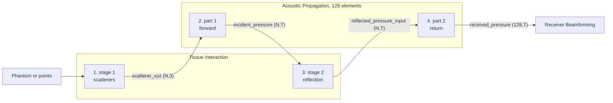
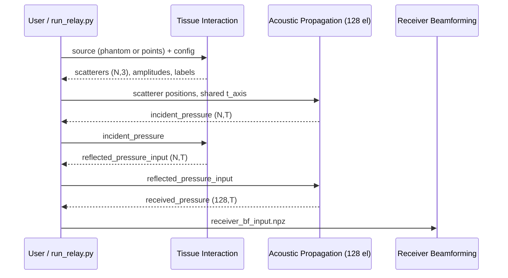

# Architecture

## Layers
| Layer | Folder | Rule |
|---|---|---|
| **Modules** | `teams/Tn_name/` | One team, one folder. Runs and tests on its own. Never imports another module. |
| **Integration** | `integration/NN_name/` | Imports modules, passes data between them, owns no physics. |
| **Docs** | `docs/` | Contracts and guides shared by everyone. |

## Data flow of integration 01

## Single source of truth
`teams/T3_Acoustic_Propagation/code/nitk_usoundsim/config.py` defines the array (128 elements, pitch, f0, fs, c).
The relay derives the Tissue Interaction config from it (`make_ti_config`), so the two modules cannot disagree.

## Conventions every hand-over follows
- Position arrays are metres, columns `x, y, z`, row *i* = scatterer *i* in every `(N, T)` array.
- Time is seconds on one shared `t_axis`; time zero is the start of transmission.
- Pressure is in arbitrary units (a.u.).
- Full field-by-field description: [06_DATA_DICTIONARY.md](06_DATA_DICTIONARY.md); original Tissue Interaction / Acoustic Propagation agreement: [TI_AP_INTERFACE_CONTRACT.md](TI_AP_INTERFACE_CONTRACT.md).

## Physics decisions
| Decision | Default | Why |
|---|---|---|
| Who applies attenuation | Tissue Interaction (`attenuation_owner="tissue"`), Acoustic Propagation runs with alpha0 = 0 | tissue-specific attenuation and shadows; nothing counted twice |
| Final baton | Acoustic Propagation part 2 (uniform c = 1540 m/s) | matches the Team 3 design |
| Alternative baton | TI stage 3 (tissue-aware delays, spreading, directivity) | saved as `alt_ti_stage3_channel_data.npz`; use one, never both |
| Transmit focusing | none (`tau_tx = 0`) | hook: `RelayConfig.tau_tx` for the Transmit BF team |

## Sequence of one run

## Error handling and extension points
| Point | Behaviour |
|---|---|
| Row count mismatch between scatterer list and an (N,T) array | `ValueError` naming both sizes (TI and AP check) |
| Unknown attenuation owner | `ValueError` at config build |
| Transmit focusing | `RelayConfig.tau_tx` (per-element delays) |
| Alternative echo model | `also_ti_channel=True` adds TI stage 3 |
| New runner | see [11_DEVELOPER_GUIDE.md](11_DEVELOPER_GUIDE.md), section 6 |

## Design principles
1. Modules stay independent; only the integration layer knows both.
2. One shared time axis and one row order for all per-scatterer arrays.
3. Every hand-over is a self-describing file that a team can open without our code.
4. Fast code never replaces reference code; it is tested against it.
